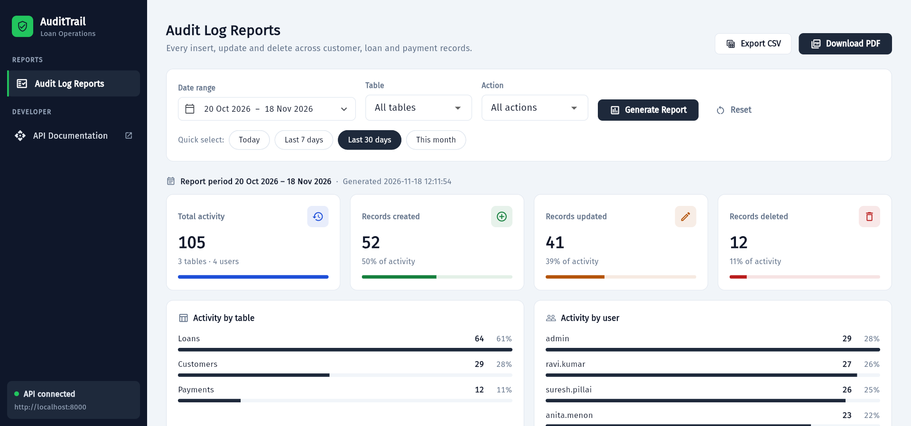
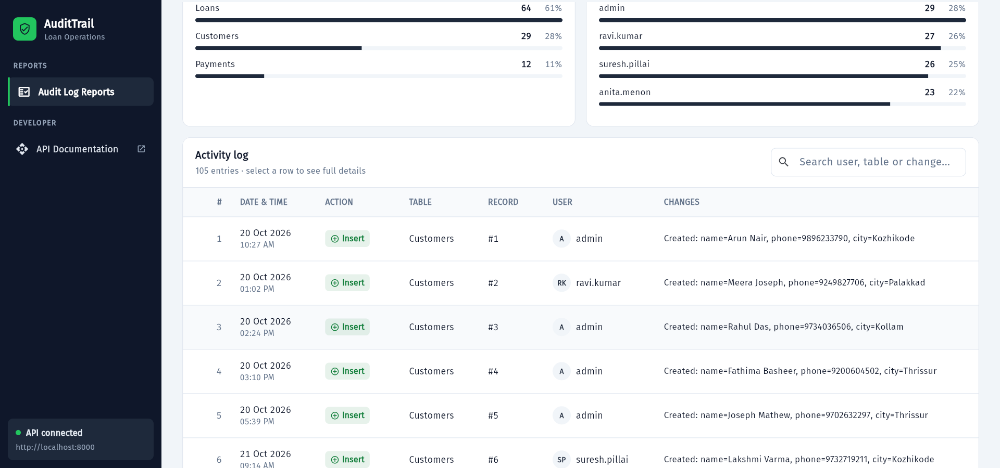
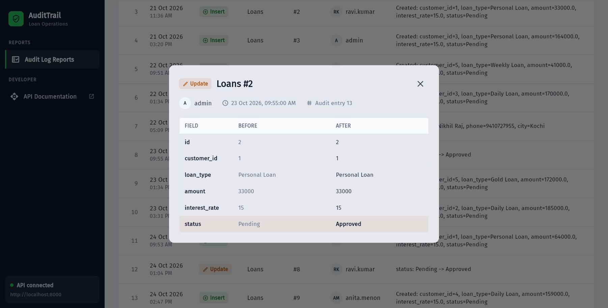
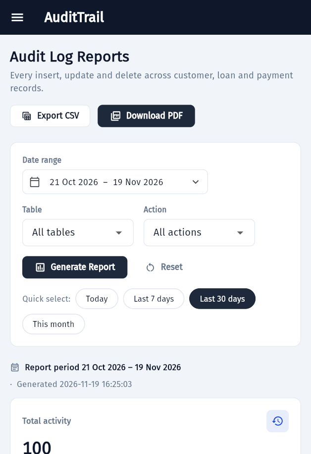
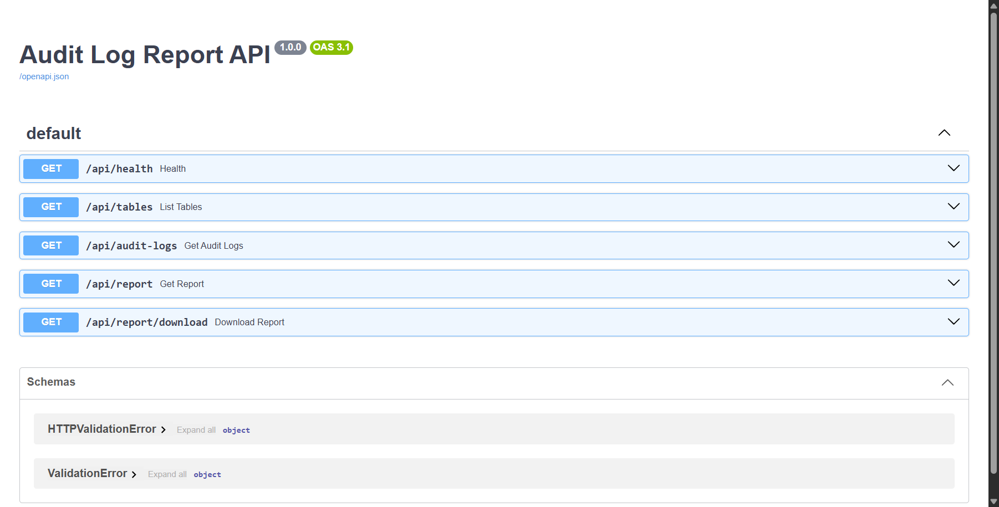

# Audit Log Report Generation System

A simple system that records every **INSERT**, **UPDATE** and **DELETE** on a simulated
loan-management database and lets users generate, view and download audit reports for any
date range.

| Layer     | Technology                         |
|-----------|------------------------------------|
| Backend   | Python 3.11+, FastAPI              |
| Frontend  | Flutter (Web / Windows / Mobile)   |
| Database  | SQLite (simulated, auto-created)   |
| Export    | PDF (fpdf2) and CSV                |

---

## Screenshots

### Dashboard overview
Date range with quick presets, table/action filters, summary cards and activity breakdowns.



### Activity log
Searchable, paginated audit table with action badges, users and readable change summaries.



### Record details
Selecting a row shows every field before and after the change; changed fields are highlighted.



### Mobile layout
The dashboard adapts to small screens; the sidebar moves into a menu.



### API documentation (Swagger)
Interactive API docs served by FastAPI at `/docs`.



---

## Project Structure

```
task1/
├── backend/                      FastAPI application
│   ├── main.py                   API endpoints
│   ├── database.py               Schema, audit triggers, sample data
│   ├── reports.py                Report building + CSV/PDF export
│   ├── generate_sample_report.py Creates the sample report files
│   ├── test_api.py               Automated API tests
│   └── requirements.txt
├── frontend/                     Flutter dashboard
│   └── lib/
│       ├── main.dart
│       ├── config.dart           Backend URL
│       ├── theme/app_theme.dart  Colours, typography, component styles
│       ├── models/audit_report.dart
│       ├── services/api_service.dart
│       ├── screens/dashboard_screen.dart
│       └── widgets/              Sidebar, filters, KPI cards, table, detail dialog
├── database/
│   └── audit_demo_dump.sql       Full SQL dump of the simulated database
├── docs/screenshots/             Screenshots used in this README
└── sample_report/
    ├── audit_report_sample.pdf   Sample generated report
    └── audit_report_sample.csv
```

---

## How It Works

1. **Business tables** – `customers`, `loans`, `payments`. Loan products and interest rates
   follow the reference projection sheet: Gold 18%, Vehicle 14%, Personal / Weekly / Daily 15%.
2. **Audit triggers** – each table has `AFTER INSERT / UPDATE / DELETE` triggers that write to
   `audit_log` automatically, storing the old and new row as JSON plus the user and timestamp.
   Because auditing happens in the database, no change can bypass it.
3. **Sample activity** – on first start the backend creates ~30 days of realistic activity:
   customer registration, loan applications, approvals, disbursements, payments, rate
   revisions, rejected applications and payment reversals.
4. **Report API** – filters the audit log by date range (and optionally table / action),
   converts the JSON snapshots into readable text such as `status: Pending -> Approved`, and
   returns summary counts.
5. **Dashboard** – pick a date range, generate the report, view it in a table, download PDF/CSV.

### `audit_log` table

| Column       | Description                                  |
|--------------|----------------------------------------------|
| id           | Audit entry ID                               |
| table_name   | Table that changed                           |
| record_id    | ID of the changed row                        |
| action       | `INSERT`, `UPDATE` or `DELETE`               |
| old_data     | Row before the change (JSON, null on insert) |
| new_data     | Row after the change (JSON, null on delete)  |
| changed_by   | User who made the change                     |
| changed_at   | `YYYY-MM-DD HH:MM:SS`                        |

---

## Running the Project

### 1. Backend

```bash
cd backend
python -m venv .venv
# Windows: .venv\Scripts\activate     macOS/Linux: source .venv/bin/activate
pip install -r requirements.txt
uvicorn main:app --reload
```

- API: http://localhost:8000
- Interactive API docs (Swagger): http://localhost:8000/docs
- The database file `backend/audit_demo.db` is created automatically on first run.
  Delete it to regenerate fresh sample data.

Run tests:

```bash
pytest -q
```

Regenerate the sample report:

```bash
python generate_sample_report.py
```

### 2. Frontend (Flutter)

Requires Flutter 3.35 or newer (`flutter --version`). Start the backend first.

```bash
cd frontend
flutter pub get
flutter run -d chrome
```

Notes:
- The dashboard font (Fira Sans) loads from Google Fonts, so the first load needs internet.
- Building the Windows desktop app needs Windows Developer Mode on
  (`start ms-settings:developers`). Chrome / web does not.

To point the app at a different backend URL (e.g. Android emulator):

```bash
flutter run --dart-define=API_BASE_URL=http://10.0.2.2:8000
```

---

## API Reference

| Method | Endpoint               | Description                              |
|--------|------------------------|------------------------------------------|
| GET    | `/api/health`          | Health check                             |
| GET    | `/api/tables`          | Audited tables and tracked columns       |
| GET    | `/api/audit-logs`      | Raw audit records for a date range       |
| GET    | `/api/report`          | Report: summary + readable records       |
| GET    | `/api/report/download` | Download report (`format=pdf` or `csv`)  |

Query parameters:

| Parameter    | Required | Example                              |
|--------------|----------|--------------------------------------|
| `start_date` | yes      | `2026-11-01`                         |
| `end_date`   | yes      | `2026-11-18`                         |
| `table`      | no       | `customers`, `loans`, `payments`     |
| `action`     | no       | `INSERT`, `UPDATE`, `DELETE`         |

Example request:

```
GET /api/report?start_date=2026-11-01&end_date=2026-11-18&action=UPDATE
```

Response shape (abridged):

```json
{
  "title": "Audit Log Report",
  "start_date": "2026-11-01",
  "end_date": "2026-11-18",
  "generated_at": "2026-11-18 09:38:35",
  "summary": {
    "total": 25,
    "by_action": { "INSERT": 0, "UPDATE": 25, "DELETE": 0 },
    "by_table": { "loans": 18, "customers": 7 },
    "by_user": { "admin": 7, "ravi.kumar": 6, "anita.menon": 6, "suresh.pillai": 6 }
  },
  "records": [
    {
      "id": 15,
      "timestamp": "2026-11-02 11:20:00",
      "table": "loans",
      "record_id": 4,
      "action": "UPDATE",
      "user": "anita.menon",
      "changes": "status: Pending -> Approved",
      "old_data": { "id": 4, "status": "Pending" },
      "new_data": { "id": 4, "status": "Approved" }
    }
  ]
}
```

---

## Notes

- All data is simulated; there is no connection to any production database.
- CORS is open (`*`) so the Flutter web app can call the API locally. Restrict
  `allow_origins` in `main.py` before any non-local deployment.
- There is no login; the user on each audit entry comes from the simulated activity.
